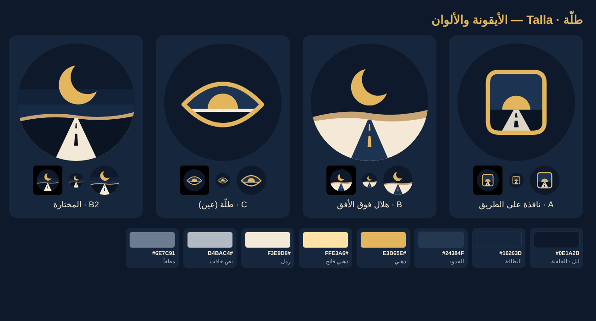

# Talla · طلّة



A glance at your day from the car. Talla (until 1.x "Bayti Auto · بيتي في السيارة") is the in-car companion of [Bayti TV](https://github.com/HMubaireek/bayti-tv). It is an Android Auto app that runs on the phone and draws a Bayti-style screen on the car's display:

- the clock
- the Hijri and Gregorian dates in Arabic
- your phrase for each part of the day
- the weather where the car is
- the next prayer (Jafari by default, for Al-Mallaha, Al-Qatif)
- your team's next match (Al-Hilal unless you pick another league and team)
- a photo carousel
- the car's own fuel and range, where the car sends them: a warning when low, with the nearest petrol station
- a background photo with Bayti TV's veil, grain and slow settle

Every item can be switched on or off in the app's settings on the phone. The settings screen also shows a live preview of the car's screen.

Made for a 2019 Mazda CX-9 (Mazda Connect, wired Android Auto, 800 × 480). The layout scales to any car screen.

## Install on your phone

Android Auto only lists an app like this one when Google Play is recorded as its installer. Tapping the APK file installs it, but Android Auto then **won't show it**. "Unknown sources" in Android Auto's developer settings does not cover this kind of app. Install it through **Shizuku + UnknownAuto** (or KingInstaller) instead:

1. **Get the APK.** Download `talla.apk` from the [apk-latest release](../../releases/tag/apk-latest).
2. **Install Shizuku** from Google Play.
3. **Turn on Wireless debugging.** Enable Developer options on the phone (Settings → About phone → tap *Build number* 7 times). Then go to Developer options → *Wireless debugging* and turn it on.
4. **Start Shizuku.** In Shizuku choose *Start via Wireless debugging* and pair it with the code the phone shows. Wi-Fi must be on to start it; it doesn't have to stay connected.
5. **Install UnknownAuto** from [its releases](https://github.com/GitMag/UnknownAuto/releases) and allow it in Shizuku.
6. **Install Talla through it.** In UnknownAuto pick `talla.apk` and tap *Install*. Wait for its ✔ banner, then tap *Update* as well: on some phones (Android 17) only that second pass keeps the Play installer mark Android Auto needs.
7. **Set it up.** Open **طلّة** on the phone:
   - allow location (for the weather where the car is)
   - pick your photos folder under «صوري»
   - choose what to show, and «فريقك» (a league, then a team)
8. **Turn on Android Auto's developer mode** on the phone. It isn't required, but it helps when testing:
   - Android Auto settings → *Version* → tap it 10 times
   - in the ⋮ menu: Developer settings → *Unknown sources* on
9. **In the car.** Plug the phone in. Open the app grid on the Mazda screen and choose **طلّة**.
   - One pale button (a small landscape) moves to the next background. Android Auto hides it after a few seconds; a touch or the knob
     brings it back. (The navigation template must have at least one button.)
   - «تخفيف الإضاءة» dims the screen: automatically when the car switches to its night look, always, or never; and by how much.
   - «بطاقة الوسائط» (off by default) adds Talla as a media app as well, so in split view it can sit as a card beside Google Maps.
     It plays no sound, but takes the media card's place from YouTube Music while it is the chosen media app.

**Updates:** on the phone alone, «التحديث من الهاتف» in the app downloads the newest `talla-<version>.apk` into Download and opens Shizuku and UnknownAuto. Install each new APK the same way, through UnknownAuto. Installing it any other way loses the Play attribution, and the app disappears from the car until you reinstall.

UnknownAuto and Shizuku are third-party tools; this project has not audited them. If Android Auto ever stops accepting the app, there are two other routes:
- a $25 Google Play developer account, with the app on an internal test track (only you can install it)
- KingInstaller, which uses the same Play-installer method

## From Bayti Auto (1.x) to Talla (2.0)

2.0 has a new package name (`sa.talla`), so Android installs it as a new app beside Bayti Auto. Set it up again (photo folder,
place, phrases, team), check it shows in the car, then uninstall Bayti Auto.

## Why it is a "navigation" app

Android Auto apps are built with Google's Car App Library. Most of them may only use fixed templates: system fonts, few images, nothing custom drawn.

Only map-type apps get a surface to draw on, and only a navigation app gets it full-screen. The weather category's map template always puts a list panel over part of the screen. So this app declares the navigation category and draws everything itself with Tajawal on that surface.

Google Play would not accept a non-navigation app in that category. That's fine for a personal app installed by its owner.

## Driving

- **Drawing rate.** The screen redraws once a minute for the clock. It animates only while a photo cross-fades or settles (about 30 frames a second, for at most a minute), and the settle can be switched off («حركة الصور الهادئة»).
- **Touch.** Mazda locks the touchscreen while moving. Parked, a swipe on the screen moves the carousel on.
- **Split view.** In Android Auto's split view the app gets a panel of the screen; the layout and the photo follow that panel. Only one
  navigation app can hold the map side, so this app and Google Maps can't be on the screen together.

## Data

| What | Source | How often |
|---|---|---|
| Weather and dust | [Open-Meteo](https://open-meteo.com) | every 30 minutes; an answer older than 3 hours is hidden |
| Prayer times | computed on the phone (PrayerCalc); matches Aladhan to the minute | no network needed |
| Hijri date | Android's Umm al-Qura calendar, with an adjustment of ±2 days | no network needed |
| Your team's next match | [TheSportsDB](https://www.thesportsdb.com); leagues, clubs and Arabic names bundled from Bayti TV's lists (`tools/teams.py`) | every 3 hours, and again after a match |
| Fuel, range, speed | the car itself, through Android Auto (if the car sends them) | live while Talla is on the screen |
| Nearest petrol station | [OpenStreetMap](https://www.openstreetmap.org) (Overpass API) | only while the fuel is low |
| Photos | Bayti TV's Saudi set, Wikimedia Commons featured pictures, Bing's photo of the day, your own folder | lists daily; photos cached on the phone (80 kept) |

## Build

The `Android` workflow builds the signed APK on every push to `master`. You can also start it by hand.

It needs two repository secrets:
- `ANDROID_KEYSTORE_B64`: the base64 of the `.p12` key
- `ANDROID_KEYSTORE_PASSWORD`

The key is never committed. A local build without `ANDROID_KEYSTORE` is signed with the debug key.

```bash
./gradlew assembleRelease
```

## Licence

MIT for this project's code. Tajawal is under the SIL OFL 1.1. See [LICENSE](LICENSE).
